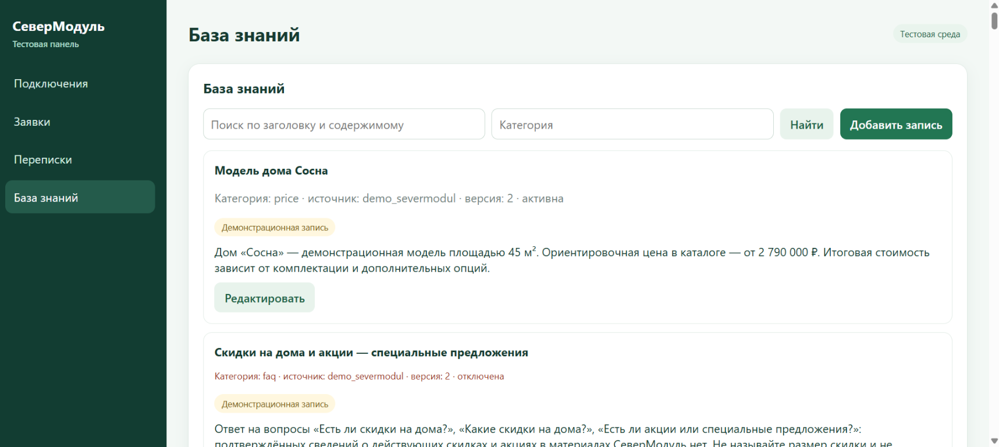
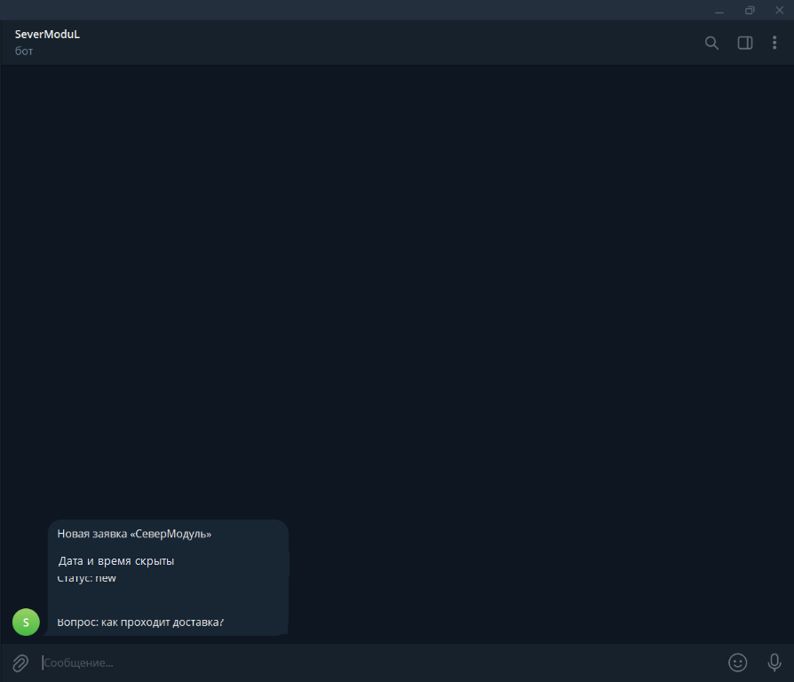

# SeverModul

SeverModul — демонстрационный сайт для компании модульных домов. Проект объединяет каталог и калькулятор с AI-чатом поддержки, формой заявки и закрытой административной панелью.

> Это демонстрационный проект, а не заказ для реального клиента. Записи базы знаний и ответы требуют проверки и не являются подтверждёнными условиями компании.

## Моя роль

Разработала и дорабатывала интерфейс сайта, чат, интеграцию с серверной функцией и административную панель. В работе использовался ИИ-ассистент.

## Возможности

- Каталог проектов домов и калькулятор стоимости.
- AI-чат поддержки: поиск информации в базе знаний и формирование ответа с помощью Groq API.
- Сохранение истории диалогов в PostgreSQL.
- Форма для отправки заявки с именем, контактом и вопросом.
- Админ-панель для просмотра заявок и диалогов, поиска по имени и контакту, фильтрации и смены статусов заявок.
- В админ-панели можно просматривать переписки и искать, добавлять, редактировать, включать и отключать записи базы знаний. Удаление записей базы знаний через панель не реализовано.
- Telegram Bot API: тестовое уведомление о новой заявке успешно получено в Telegram.

## Архитектура и технологии

- **Клиент:** HTML, CSS, JavaScript — статическая часть сайта и интерфейс чата.
- **Сервер:** TypeScript и Neon Functions — обработка запросов чата, формы и административных действий.
- **Данные:** Neon PostgreSQL (`pg`) — записи базы знаний, заявки и история диалогов.
- **AI:** Groq API — генерация ответа на основе материалов, найденных в базе знаний.
- **Уведомления:** Telegram Bot API — отправка уведомления о новой заявке в настроенный чат.
- **Публикация сайта:** Netlify.

Поиск по базе знаний не описывается как векторный RAG или semantic search: проект обращается к PostgreSQL и использует найденные материалы для подготовки ответа.

### Как обрабатывается заявка

1. Посетитель отправляет через форму имя, контакт и вопрос.
2. Серверная функция сохраняет заявку в PostgreSQL и связывает её с диалогом.
3. После этого настроенный Telegram Bot API отправляет уведомление о новой заявке.
4. Администратор может открыть заявку в панели, просмотреть её данные и историю диалога, а также обновить статус.

Скриншот тестового уведомления приложен ниже; имя, контакт и идентификатор заявки скрыты.

### Административная панель

Панель доступна по маршруту `/?action=admin` после входа администратора. Реализованы просмотр заявок и связанных диалогов, просмотр списка переписок, поиск и фильтрация заявок, изменение статуса, а также поиск, добавление, редактирование и включение/отключение записей базы знаний.

Доступ защищён серверной проверкой пароля и подписанной ограниченной по времени сессией. Для работы панели в окружении Neon Function нужны `DATABASE_URL`, `ADMIN_PASSWORD` и `ADMIN_SESSION_SECRET`; для генерации ответов чата нужен `GROQ_API_KEY`. Значения секретов не включаются в статический сайт, README или скриншоты.

## Скриншоты

*Главная страница сайта с открытым чатом.*

*Пример ответа AI-консультанта по материалам базы знаний.*

*Управление демонстрационными записями базы знаний в тестовой панели.*

*Полученное тестовое уведомление; идентификатор, имя и контакт скрыты.*

## Ссылки

- **Демо:** [https://moduldoma.netlify.app/](https://moduldoma.netlify.app/)
- **GitHub:** [https://github.com/tsurkaneleonora-hash/SeverModul](https://github.com/tsurkaneleonora-hash/SeverModul)

## Диалоги, заявки и Telegram

Работа интеграции подтверждена на production: заявка с сайта успешно сохранилась в Neon PostgreSQL, а уведомление о ней пришло в Telegram. Секреты хранятся в серверном окружении и не публикуются.
