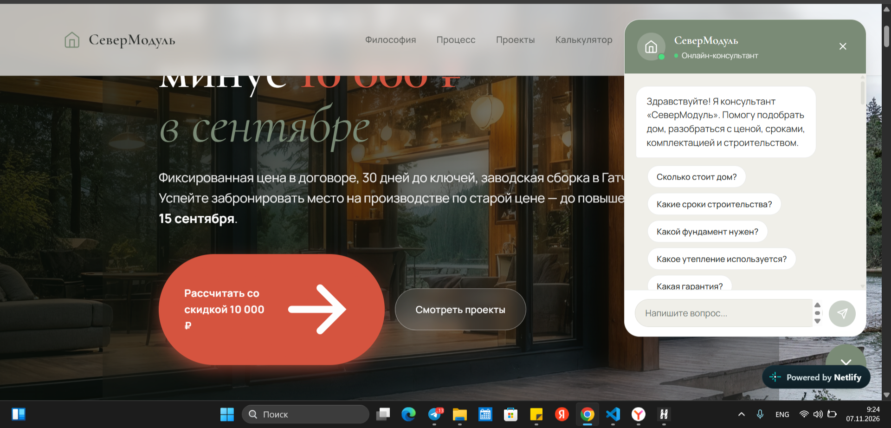
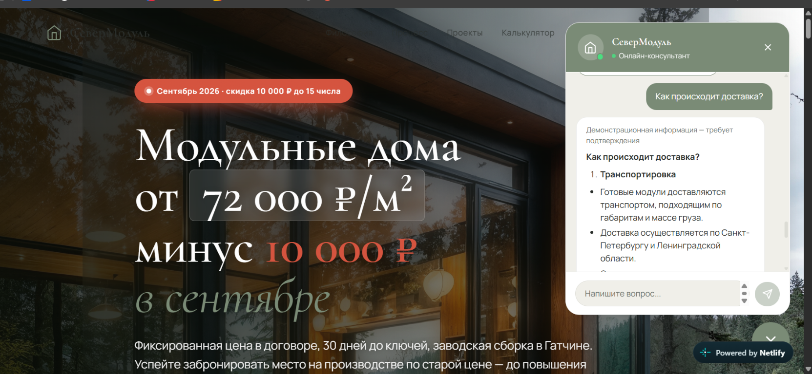

# SeverModul

Демонстрационный сайт для проекта модульных домов. На странице представлены проекты домов и калькулятор, а чат-консультант помогает найти ответы в базе знаний. Серверная функция обращается к PostgreSQL и может формировать ответ с помощью Groq. Данные базы в текущем проекте демонстрационные и требуют проверки; это не подтверждение работы с реальными клиентами или производственной готовности.

## Моя роль

Автор и разработчик демонстрационного проекта: создавала и дорабатывала интерфейс сайта, чат и серверную интеграцию. В работе использовался ИИ-ассистент. Проект не описывается как заказ для реального клиента.

## Технологии

- HTML, CSS и JavaScript — интерфейс сайта и чат.
- TypeScript и Neon Functions — серверная функция чата.
- PostgreSQL и `pg` — база данных и поиск по базе знаний.
- Groq API — генерация ответов по найденным материалам.
- Netlify — публикация статической части сайта (согласно документации проекта).

## Ссылки

- **Сайт:** [moduldoma.netlify.app](https://moduldoma.netlify.app/)
- **GitHub:** [tsurkaneleonora-hash/SeverModul](https://github.com/tsurkaneleonora-hash/SeverModul)

## Скриншоты

### Главный скриншот

*Главная страница сайта и AI-чат поддержки*

*Пример ответа AI-консультанта на вопрос о доставке*

### Уже сохранено на компьютере

В `../severmodskrin/` найдено 20 PNG-файлов:

- `2026-11-07_09-24-37.png` — исходный скриншот главной страницы SeverModul с открытым чатом; копия `screenshots/main-chat.png` добавлена в этот раздел портфолио.
- `2026-10-08_14-37-12.png` — сайт с чатом, но на скриншоте видны редактор, терминал и рабочая переписка; лучше переснять.
- `2026-11-06_18-38-19.png` — панель Netlify, а не демонстрация самого сайта.
- `2026-11-05_20-04-28.png`, `2026-11-05_20-53-18.png`, `2026-11-05_21-10-21.png` и `2026-11-06_14-51-35.png` — материалы настройки и администрирования; не использовать в портфолио. В `2026-11-05_20-53-18.png` виден секрет — не копировать и не публиковать.
- `2026-10-08_15-03-04.png` — настройки API-ключей Neon; это личная панель, к демонстрации проекта не подходит.
- `2026-10-08_14-37-32.png`, `2026-10-08_17-20-52.png`, `2026-11-06_17-07-17.png` — Discord или экран входа Netlify, к демонстрации проекта не подходят.
- `Снимок экрана 2026-09-26 092224.png`, `Снимок экрана 2026-09-26 092823.png`, `Снимок экрана 2026-09-26 102159.png`, `Снимок экрана 2026-09-26 102351.png`, `Снимок экрана 2026-09-26 102952.png`, `Снимок экрана 2026-09-26 103513.png`, `Снимок экрана 2026-09-26 104034.png`, `Снимок экрана 2026-09-26 104105.png` и `Снимок экрана 2026-09-26 104440.png` — скриншоты другого проекта, FinanceTreker.

Дополнительно найдены `images/width_1024.jpg` (портрет, не скриншот проекта) и пустая папка `скрины мод.дом`. Скриншоты, отправленные только в чате, среди локальных файлов не обнаружены.

### Что доснять

- Чистый первый экран сайта без редактора, терминала и личных панелей.
- Каталог проектов домов.
- Калькулятор в заполненном состоянии и его результат.
- Диалог с чат-консультантом на нейтральном демонстрационном вопросе; проверить, чтобы в ответе не было неподтверждённых обещаний.
- Адаптивный вид на телефоне.

Перед добавлением изображений убрать личные данные, ключи, пароли, внутренние адреса и тестовые заявки. Исходные скриншоты не перемещались и не изменялись.
